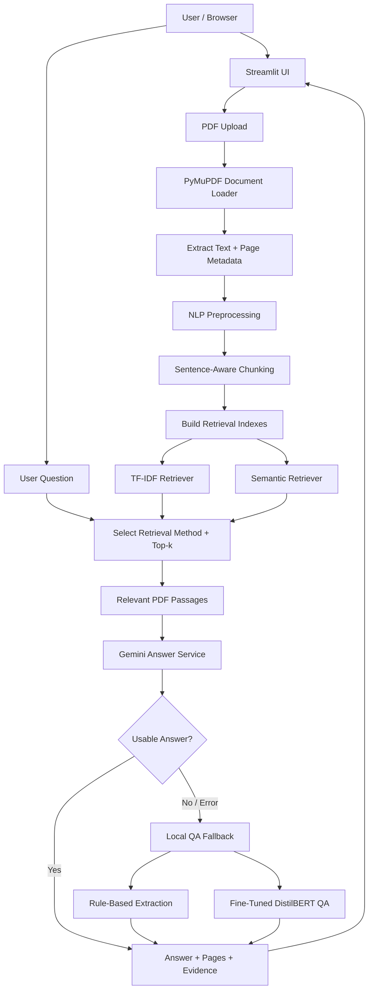

<div align="center">

# 📄 DocuQuery AI

### A PDF Question Answering System with Retrieval-Augmented Generation

**Upload a document. Ask questions. Retrieve relevant evidence. Get AI-generated answers with supporting passages.**

[](https://www.python.org/)
[](https://streamlit.io/)
[](https://pymupdf.readthedocs.io/)
[](https://www.sbert.net/)
[](https://ai.google.dev/)

<!-- Add a deployed demo link here if you publish the application. -->
<!-- [**Live Demo**](YOUR_DEMO_URL) · [**GitHub Repository**](YOUR_REPOSITORY_URL) -->

</div>

---

## 📌 Overview

DocuQuery AI is a PDF question-answering application that helps users find and understand information inside uploaded documents. It extracts text and page information from a PDF, prepares overlapping text chunks, and indexes them using two retrieval approaches: **TF-IDF** and **semantic search**.

When a user asks a question, the selected retriever returns the most relevant passages. The application first attempts to generate a grounded natural-language answer with **Google Gemini**. If the Gemini response cannot be used, a local fallback can answer through rule-based extraction and a fine-tuned **DistilBERT extractive QA model**.

The interface displays the answer along with page references and retrieved evidence passages so users can inspect the source material.

> **Project positioning:** DocuQuery AI is a document question-answering assistant. It supports evidence-oriented exploration of text-based PDFs; it is not a legal advisor or a guarantee that every generated answer is correct.

---

## 🎯 Problem Statement

Reading lengthy documents to locate a particular clause, date, amount, or condition can be time-consuming. Traditional keyword search may also miss relevant passages when a question uses different wording from the document.

DocuQuery AI addresses this by combining:

- **PDF text extraction:** Extract document text while retaining page information.
- **Text preparation:** Clean and organize extracted content for retrieval.
- **Chunking:** Divide long documents into manageable, overlapping passages.
- **Multiple retrieval options:** Search with TF-IDF or semantic similarity.
- **Question answering:** Use Gemini for natural-language responses and local QA as a fallback.
- **Evidence display:** Show retrieved passages and page references alongside answers.

### Design goal

Make document information **easier to search, retrieve, inspect, and understand**, while keeping the source evidence visible to the user.

---

## ✨ Features

### 📄 PDF Processing
- Upload a PDF through the Streamlit interface.
- Extract text page by page using PyMuPDF.
- Preserve page metadata for evidence references.
- Preprocess extracted text before indexing.
- Split content into overlapping chunks.

### 🔎 Dual Retrieval System
- **TF-IDF retrieval:** Rank passages using statistical lexical relevance.
- **Semantic retrieval:** Use `sentence-transformers/all-MiniLM-L6-v2` embeddings to find semantically similar passages.
- Select the retrieval method from the application interface.
- Adjust the number of retrieved passages using the top-k control.

### 🤖 Gemini Answer Generation
- Send the user's question and retrieved evidence to Gemini.
- Use system instructions to encourage evidence-grounded answers.
- Instruct the model to avoid inventing unsupported facts and to abstain when evidence is insufficient.
- Use a low generation temperature (`0.2` in the configured service).

### 🧠 Local QA Fallback
- Use rule-based extraction for supported question patterns and document facts.
- Use a fine-tuned DistilBERT extractive QA model to predict answer spans in context.
- Return extracted text rather than freely generated answers for the DistilBERT path.
- Provide a fallback when Gemini fails or its answer is considered unusable.

### 📑 Answer & Evidence Display
- Display the answer in Streamlit.
- Show the answering method where available.
- Display referenced page numbers.
- Expand retrieved passages to inspect the supporting text.

---

## 🖥️ Application

### Run Locally

The application is run through Streamlit:

```powershell
streamlit run app/ui/streamlit_app.py
```

Open the local URL printed in the terminal, typically:

**http://localhost:8501**

### Example Questions

Questions depend on the content of the uploaded PDF. For a rental agreement, examples may include:

- What is the monthly rent?
- When is the rent due?
- What is the security deposit?
- Is there a rent escalation clause?
- Who is responsible for property tax?

These are example prompts, not guaranteed answers for every document.

<!-- Add actual application screenshots below after capturing them. -->
<!--
### Application Screens

| PDF Upload | Answer & Evidence |
|:---:|:---:|
|  |  |
-->

---

## 🏗️ System Architecture

DocuQuery AI separates document ingestion, preprocessing, retrieval, answer generation, and UI responsibilities.



### Architecture principles

- **Separation of concerns:** UI, PDF processing, retrieval, and answering are implemented in separate modules.
- **Evidence-first retrieval:** Answering methods receive retrieved document passages as context.
- **Selectable retrieval:** TF-IDF and semantic retrieval are alternative search methods.
- **Fallback answering:** Local QA can be used when Gemini is unavailable or its response is unusable.
- **Page traceability:** Retrieved chunks retain page metadata for displaying source references.
- **No guaranteed correctness:** Retrieval and answer generation can still produce incorrect or incomplete results.

---

## 🔁 How It Works

### 1. PDF Ingestion & Text Extraction

The Streamlit upload flow passes the PDF to `DocumentPipeline`. The document loader uses **PyMuPDF** to extract text page by page and retain page information.

```text
PDF
 ↓
PyMuPDF
 ↓
Extracted page text + page numbers
```

Text extraction works for PDFs with a usable text layer. Image-only scanned PDFs may require OCR, which is not established as part of the current pipeline.

### 2. NLP Preprocessing & Chunking

The preprocessing module normalizes text and uses NLTK sentence tokenization to prepare content for chunking and retrieval. Meaningful content such as negations, amounts, dates, and percentages should be preserved.

The project is configured around:

| Parameter | Value |
|---|---:|
| Chunk size | Approximately 120 words |
| Chunk overlap | 30 words |
| Chunking | Sentence-aware |

Sentence-aware boundaries can make actual chunk sizes vary from the configured target.

**Why overlap?** Overlap helps preserve context when a clause or explanation spans a chunk boundary.

### 3. Build Retrieval Indexes

The processed chunks are indexed through two retrieval implementations:

| Retrieval | Implementation | Main idea |
|---|---|---|
| TF-IDF | `app/retrieval/tfidf_retriever.py` | Statistical lexical matching |
| Semantic | `app/retrieval/semantic_retriever.py` | Similarity between text embeddings |

Semantic retrieval uses:

```text
sentence-transformers/all-MiniLM-L6-v2
```

The model encodes passages and questions as vectors. The project normalizes embeddings and compares them using dot product, equivalent to cosine similarity for normalized vectors.

### 4. Retrieve Top-k Passages

When a question is submitted, the selected retriever ranks the document chunks and returns the configured top-k passages.

```text
Question
  ↓
Selected retriever
  ↓
Rank document chunks
  ↓
Top-k relevant passages
  ↓
Answering service
```

Top-k controls how many passages are supplied as context. It does not represent the number of answers or PDF pages.

### 5. Generate or Extract an Answer

The application attempts Gemini first:

```text
Question + Retrieved Passages + System Instructions
                         ↓
                     Gemini API
                         ↓
                 Natural-language answer
```

If Gemini fails or its response is considered unusable, the local QA service is invoked:

```text
Question + Retrieved Context
             ↓
       Local QA Service
          /        \
   Rule-based    DistilBERT
   extraction    span prediction
          \        /
        Local answer
```

The local fallback is not guaranteed to be correct. Rule-based logic only covers implemented patterns, and extractive QA can select an incorrect text span.

### 6. Display Answer & Evidence

The Streamlit interface displays the answer and, where available:

- Answering method
- Source page references
- Retrieved evidence passages

The evidence view lets users inspect the source text rather than relying only on the answer.

---

## 🧠 AI Design: Gemini vs. DistilBERT

The two answering methods have different responsibilities.

| Component | Responsibility |
|---|---|
| Gemini | Generate a natural-language answer using retrieved passages |
| Rule-based QA | Extract facts for supported question patterns |
| DistilBERT QA | Predict the start and end token positions of an answer span |
| Retriever | Find relevant document passages |
| Streamlit | Display answers and evidence |

### Gemini Answering

Gemini receives the question and selected passages. System instructions encourage it to:

- Answer using the supplied evidence.
- Avoid inventing unsupported facts.
- Indicate when the evidence is insufficient.
- Treat uploaded document content as untrusted input.

Prompt constraints reduce risk but do not guarantee that an LLM will never hallucinate.

### DistilBERT Extractive QA

DistilBERT predicts **where the answer occurs in the supplied context**, rather than generating an unrestricted response.

The local QA implementation tokenizes the question and context, processes them through the fine-tuned model, and uses start/end logits to select an answer span. That span is decoded back into text.

For example:

```text
Context:
The monthly rent shall be ₹25,000.

Question:
What is the monthly rent?

Extracted answer:
₹25,000
```

This is an illustrative example.

---

## 🧪 DistilBERT Fine-Tuning

The project includes a fine-tuning script:

```text
training/train_qa.py
```

### Training configuration

| Parameter | Value |
|---|---|
| Base model | `distilbert/distilbert-base-cased` |
| Dataset | `rajpurkar/squad` |
| Selected examples | First 300 examples from training split |
| Task | Extractive question answering |
| Epochs | 1 |
| Batch size | 2 |
| Learning rate | `3e-5` |
| Weight decay | `0.01` |
| Maximum input length | 384 tokens |
| Environment | CPU |
| Reported training steps | 150 |
| Reported training loss | 4.304 |
| Saved model | `models/docuquery-qa` |

### What the model learns

SQuAD contains question, context, and answer-span examples. Fine-tuning teaches the model to predict the start and end positions of answers in text.

The model is **not trained on the contents of every future uploaded PDF**. At inference time, the retriever supplies relevant passages from the user's document.

> **Evaluation note:** The reported training loss is not accuracy. No separate held-out test split or verified test accuracy is documented here. Do not interpret the training loss as a measure of real-world document QA performance.

### Model files

The fine-tuned weights are stored locally under:

```text
models/docuquery-qa/
```

The large `.safetensors` model file is excluded from ordinary GitHub uploads because it exceeds GitHub's standard 100 MB file limit. The source code and training script can be published separately; model weights can be distributed through an appropriate model-hosting service if desired.

---

## 🛠️ Tech Stack

### Application

| Technology | Purpose |
|---|---|
| Python | Application and QA logic |
| Streamlit | Interactive web interface |
| PyMuPDF | PDF text extraction |
| NLTK | Sentence tokenization |
| scikit-learn | TF-IDF retrieval |
| Sentence Transformers | Semantic embeddings |
| NumPy | Vector operations |
| Transformers | DistilBERT extractive QA |
| PyTorch | Model inference and fine-tuning |
| Google GenAI SDK | Gemini integration |
| python-dotenv | Environment configuration |
| Pytest | Automated testing |

### AI & NLP

- Google Gemini — primary answer generation.
- DistilBERT — local extractive question answering.
- `all-MiniLM-L6-v2` — semantic passage retrieval.
- SQuAD — fine-tuning dataset for extractive QA.

---

## 📁 Project Structure

```text
DocuQuery-AI/
├── app/
│   ├── nlp/
│   │   └── preprocessor.py
│   ├── retrieval/
│   │   ├── tfidf_retriever.py
│   │   └── semantic_retriever.py
│   ├── qa/
│   │   └── qa_service.py
│   ├── services/
│   │   ├── document_loader.py
│   │   ├── document_pipeline.py
│   │   └── gemini_service.py
│   └── ui/
│       └── streamlit_app.py
├── training/
│   └── train_qa.py
├── tests/
│   ├── test_document_loader.py
│   ├── test_document_pipeline.py
│   ├── test_preprocessor.py
│   ├── test_qa_service.py
│   ├── test_retrievers.py
│   └── test_answer_quality.py
├── models/
│   └── docuquery-qa/
│       └── [Fine-tuned model files - not all tracked]
├── .env.example
├── .gitignore
├── requirements.txt
└── README.md
```

> The structure above highlights the main project modules. Confirm it against the current repository before treating it as a complete file listing.

---

## 🚀 Getting Started

### Prerequisites

- Python 3.13+
- Git
- Gemini API key for Gemini answering (optional if using local fallback)
- Internet connection for installing dependencies and downloading model assets when required

### 1. Clone the repository

```powershell
git clone https://github.com/Faraz-05/DocuQuery-AI.git
cd DocuQuery-AI
```

### 2. Create and activate a virtual environment

```powershell
py -m venv .venv
.\.venv\Scripts\Activate.ps1
```

### 3. Install dependencies

```powershell
python -m pip install -r requirements.txt
```

### 4. Configure environment variables

Create a local `.env` file in the project root. You can start from `.env.example` if it is included:

```powershell
Copy-Item .env.example .env
```

Configure the Gemini credentials and model setting in `.env`:

```env
GEMINI_API_KEY=your_gemini_api_key
GEMINI_MODEL=your_supported_gemini_model
```

Do not commit `.env` or expose API keys in public repositories.

### 5. Start DocuQuery AI

From the project root, in the activated VS Code terminal:

```powershell
streamlit run app/ui/streamlit_app.py
```

Open the local address shown in the terminal, usually:

**http://localhost:8501**

Upload a PDF, choose a retrieval method, adjust top-k, and ask a question.

### 6. Run tests

```powershell
python -m pytest -q
```

Previously, the project had a test run reporting **39 passed and 1 warning**. Rerun tests on the current commit before using that result as a release guarantee.

---

## ⚙️ Environment Configuration

### Gemini variables

| Variable | Purpose |
|---|---|
| `GEMINI_API_KEY` | Gemini API credential |
| `GEMINI_MODEL` | Gemini model selection |

The exact model available to an account can change. Configure a model supported by the Gemini API account.

### Security

- Keep `.env` out of Git.
- Never publish API keys in source files or screenshots.
- Keep model weights out of ordinary Git commits when they exceed GitHub's file-size limit.
- Uploaded documents may contain sensitive information; use documents you are authorized to process.

---

## 🧪 Testing & Quality

The repository includes tests for areas such as:

- PDF loading and extraction.
- Document pipeline behavior.
- Preprocessing and chunking.
- TF-IDF and semantic retrieval.
- Local QA behavior.
- Answer quality checks.

Previously reported test result:

| Test run | Result |
|---|---:|
| Pytest | 39 passed |
| Warning | 1 |

This is a historical test result, not a guarantee that the latest commit passes. Run the test suite locally to verify the current state.

---

## ⚠️ Limitations & Future Work

### Current limitations

- Retrieval can miss relevant clauses or return irrelevant passages.
- Gemini can generate incorrect or unsupported answers despite prompt constraints.
- Rule-based fallback covers only implemented patterns.
- DistilBERT may extract an incorrect answer span.
- Fine-tuning used a small subset of SQuAD; domain-specific legal QA performance is not established.
- No verified held-out QA accuracy is documented.
- Text extraction alone does not handle image-only scanned PDFs through OCR.
- The application is not a substitute for legal or professional review.
- Persistent multi-document storage or a database is not established in the current workflow.

### Future improvements

- Add OCR support for scanned PDFs.
- Evaluate retrieval using precision/recall or ranking metrics.
- Evaluate answer quality on a held-out, document-specific QA dataset.
- Add answer faithfulness checks and stronger citation verification.
- Support multi-document search and persistent document collections.
- Improve chunking and metadata-aware retrieval.
- Add document previews and clickable page references.
- Add user sessions and document management.
- Add deployment, monitoring, and end-to-end tests.

---

## 💡 What I Learned

This project brought together several practical AI and software engineering concepts:

- Building a document ingestion and preprocessing pipeline.
- Extracting PDF text while retaining page metadata.
- Designing chunking strategies for long documents.
- Comparing lexical and semantic retrieval approaches.
- Implementing a retrieval-augmented answering workflow.
- Integrating an LLM with evidence-oriented prompts.
- Fine-tuning and running an extractive QA model.
- Designing fallback behavior when an external AI service is unavailable.
- Testing preprocessing, retrieval, and answer-generation components.
- Building an interactive document QA interface with Streamlit.

---

## 👨‍💻 Author

**Faraz Kazi**

AI & Data Science Engineering · AI/ML Projects

- GitHub: [@Faraz-05](https://github.com/Faraz-05)
- LinkedIn: [farazkazi](https://www.linkedin.com/in/farazkazi/)

---

<div align="center">

### DocuQuery AI

**Making document information easier to retrieve and understand.**

⭐ If you find this project interesting, consider giving the repository a star.

</div>


